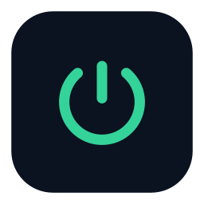
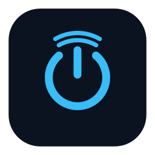

# PCDash

**English** | [Tiếng Việt](README.vi.md)

<p align="center"> </p>

Turn an old Android phone into a home controller for your Windows PC. From anywhere, including
mobile data, you can wake the PC (Wake-on-LAN), put it to sleep, hibernate, shut it down, cancel a
shutdown, and watch CPU, GPU, RAM, network and temperatures. No router port forwarding and no
cloud service of your own: remote access runs over your own Tailscale network, and the controlling
phone does not need the Tailscale app or a VPN turned on.

## How it works

```
┌─────────────────────────┐   tsnet (userspace, no VPN app)
│ Controlling phone       │ ─────────────────────────────────────┐
│ PCDash Remote           │                                      │
└─────────────────────────┘                                      ▼
                                                     ┌────────────────────┐
                                                     │ Old phone at home  │
                                                     │ PCDash host        │
                                                     │ :8091 Bearer API   │
                                                     │ :8090 web fallback │
                                                     └─────────┬──────────┘
                                                               │ Wake-on-LAN packet
                                                               │ HTTP :8799 (token)
                                                               ▼
                                                     ┌────────────────────┐
                                                     │ Windows PC         │
                                                     │ PcAgent.exe        │
                                                     └────────────────────┘
```

| Part | What it is |
|---|---|
| `app/` | **PCDash host**, Android app that stays at home on the old phone. Sends Wake-on-LAN, calls PcAgent, serves the remote API and a web dashboard, embeds its own Tailscale node. |
| `remote/` | **PCDash Remote**, Android app on the phone you carry. Tabs for control, monitoring with history charts, AI-service quota, command log. Updates itself from the host. |
| `agent/` | **PcAgent**, a small Windows service (C#, built with `csc.exe`) that runs sleep, hibernate, shutdown, abort and reports metrics. |
| `pcnet/` | Go `tsnet` library compiled to a native `.so` for both Android apps. |
| `shared/` | Pairing protocol (SRP-6a) shared by host and remote. |

## Features

- Wake, Sleep, Hibernate, Shutdown, Abort. Hibernate, Shutdown and "Forget host" ask for biometrics or the screen lock.
- Live CPU, GPU, RAM, disks, network, uptime and temperatures, with 1 h and 6 h history.
- Command log with device, time and result.
- Quota tab for AI services read through [omp](https://github.com/can1357/oh-my-pi) on the PC (optional).
- Wake PC Quick Settings tile and Wake / Sleep app shortcuts (long-press the PCDash Remote icon). They open the app, which sends the command once connected; nothing runs in the background.
- Optional alerts on the remote when the home phone goes offline or its battery is low, and optionally when the PC turns off (More > alerts, off by default). When on, the remote reads the Tailscale device list about every 15 minutes in the background, so an offline home phone is known at once without waiting on requests; the PC's state comes from the home phone, and a Sleep / Shut down sent from the remote does not raise a PC alert. Android may delay checks while the phone sits idle. When the home phone does not answer, the Control tab also says whether Tailscale shows it offline (and since when) or online with the host app not answering.
- Several PCs (up to 8): add them on the host under **PC settings > + Add a PC**. With two or more, the host shows PC chips above the power buttons and the remote a PC bar at the top (green dot = on); Control, Monitor and Quota follow the chosen PC, and so do the tile and shortcuts. Each PC keeps its own 6-hour history, and PC alerts name the PC. API: `GET /v1/pcs` and `?pc=<id>`; without it, the first PC, so older remotes keep working.
- Fast return to the app: the remote keeps its Tailscale connection for 3 minutes after you leave, shows "Connecting to Tailscale..." while it starts, has a refresh button on the status card, and reconnects by itself when the tunnel keeps failing. Power tiles animate: the icon folds into a spinner while the command runs and turns into a tick or a cross once the PC has changed state; buttons light up where you touch them.
- Optional app lock in both apps: a 6-digit passcode, with fingerprint / face unlock on Android 10+. It locks when the app opens, then at a time you choose: as soon as you leave the app, after 30 s / 1 min / 5 min away, or only when the phone screen turns off. Wrong codes trigger a growing wait.
- English and Vietnamese UI in both apps, the web dashboard and the PC setup window. The apps follow the phone language; on Android 13+ you can pick either under Settings > Apps > PCDash > Language.
- Pure-black OLED theme, glass tab bar with a sliding selection pill, screen-reader friendly labels.
- One-scan setup: the PC shows a QR code, the host phone scans it with its camera.
- Resilient host: wake locks, boot start, watchdog, battery-optimization and autostart helpers.

## Requirements

- A free Tailscale account (both phones sign in inside the PCDash apps; no OAuth keys, tags or custom ACLs).
- An always-on Android phone (host, Android 8+) on the same LAN as the PC, and a second Android phone (remote, Android 7+).
- A Windows PC with Wake-on-LAN enabled in BIOS and in the network adapter driver.
- To build: Android SDK (found at `%LOCALAPPDATA%\Android\Sdk`, or set `ANDROID_HOME`), JDK 17 (found in `~\.jdks` or Program Files, or set `PCDASH_JAVA_HOME`), Android NDK `27.1.12297006`, PowerShell 7, Go `1.27.1` or newer.

## Quick start

1. **Get the files.** Download `pcdash-host-*.apk`, `pcdash-remote-*.apk` and `pcdash-agent-windows-*.zip`
   from [Releases](https://github.com/vuuminhphuoc/pcdash-android/releases), or build them yourself:
   `.\scripts\install-go-toolchain.ps1 -Version 1.27.1` then `.\build-all.ps1`, which produces
   `app\build\pcdash-signed.apk` (host) and `remote\build\pcdash-remote-signed.apk`.
2. **Install the apps.** Open each APK on the matching phone, or `adb install -r` it.
3. **Install PcAgent on the PC.** Unzip the agent and run `install.bat` (or `agent\install.bat` in a source
   checkout), then accept the UAC prompt. It installs the
   agent for your user, opens TCP 8799 for the local subnet only, creates a secret **token** and opens a
   window with a **setup QR code** (reopen it from the Start menu, "PCDash - Ma QR cai dat", or run
   `agent\show-qr.bat`).
4. **Configure the host.** In PCDash host open **PC settings** and tap **Scan QR code from PC**. One scan fills the
   PC's LAN IP, MAC address, port and token. Review and tap **Save settings**. You can also type the values
   by hand (give the PC a DHCP reservation so the IP stays put; the token is printed by the installer).
5. **Sign in to Tailscale** on both phones inside the apps (same account).
6. **Pair.** With both phones on the home Wi-Fi, open **Remote devices -> Add device** on the
   host, then on the remote tap **Scan the QR code on the home phone** (or type the 6-character
   code). After that the remote works from anywhere.

Detailed steps, release flow, tests and ANR guardrails are in [README.vi.md](README.vi.md).

## Security

Every control path is authenticated: per-device Bearer tokens on `:8091`, an access code on the web
dashboard `:8090`, and a token on PcAgent `:8799`. Read [SECURITY.md](SECURITY.md) for the trust model,
what to keep private, and how to report a vulnerability. Never expose `:8090` or `:8799` to the Internet.

## Development

Test runners live in `scripts/` (`test-host-*.ps1`, `test-remote-java.ps1`, `test-agent-metrics.ps1`,
`test-pairing-e2e.ps1`, `lint-ui-thread.ps1`, `lint-l10n.ps1`). `scripts/perf-smoke-remote.ps1` and
`scripts/ux-walkthrough.ps1` run on real phones over adb (set `PCDASH_REMOTE_SERIAL` and
`PCDASH_HOST_SERIAL`). `.claude/skills/` holds the review skills used while developing.

**UI text.** Every string the user sees goes through `L10n.t("English", "Tiếng Việt")`
(`shared/src/vn/vuumi/pcdash/i18n/L10n.java`); labels the system shows (activity titles, the tile,
shortcuts) are in `res/values/strings.xml` and `res/values-vi/strings.xml`. `lint-l10n.ps1` fails on
Vietnamese text outside `L10n.t`.

**CI and releases.** `.github/workflows/build.yml` builds both APKs and PcAgent on Windows, runs every
test script and the pcnet Go tests on each push, and uploads the release files as a workflow artifact.
Pushing a `v*` tag also creates a draft GitHub release with `pcdash-host-<tag>.apk`,
`pcdash-remote-<tag>.apk`, `pcdash-agent-windows-<tag>.zip` and `SHA256SUMS.txt`
(`scripts/package-release.ps1` makes the same files locally). Releases must be signed with your own keys,
so the release job stops unless these repository secrets exist:

| Secret | Value |
|---|---|
| `PCDASH_HOST_KEYSTORE_B64` | `app\pcdash.keystore` as base64: `[Convert]::ToBase64String([IO.File]::ReadAllBytes("app\pcdash.keystore"))` |
| `PCDASH_REMOTE_KEYSTORE_B64` | `remote\pcdash-remote.keystore` as base64 |
| `PCDASH_KEYSTORE_PASSWORD` | Keystore password, only if it is not the default `android` |

Raise `versionCode` in `app/version.properties` and `remote/version.properties` before tagging, or phones
will not update.

## License

[MIT](LICENSE). Third-party components are listed in [THIRD_PARTY.md](THIRD_PARTY.md). PCDash is an
independent project and is not affiliated with Tailscale.
